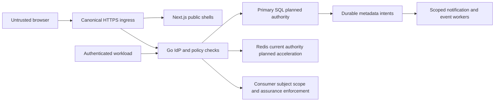

# Hatef Identity Platform - Architecture Documentation

## Status and Authority

Current-source descriptions refer to HEAD
`85abb13a27196c229efa7f59d7ef5beebb1d7e49`, inspected 2026-11-24, not deployed
acceptance. Planned sections describe the owner-confirmed target but do not
authorize application work. [Policy](authentication-and-recovery-policy.md) owns
SEC01-SEC16; [assessment](security-architecture-assessment.md) owns classified source
findings; [ADR](adr/0001-authentication-recovery-and-security-state-authority.md)
records CP01 acceptance. [Readiness](security-testing-and-readiness.md) owns release evidence.
The [backlog](../.github/tasks/registration-single-contract-tasks.md) implements
dependencies, not a second authentication service or registration-v2 route.

## 1. System Architecture

### High-Level Design

The Hatef Identity Platform is designed as a centralized, privacy-first Identity Provider (IdP) and unified access portal. It is built to serve as the Single Sign-On (SSO) gateway for the entire Hatef ecosystem (e.g., Search Engine, Email Service, and future applications), ensuring strict separation of concerns and maximum scalability.

- **Frontend Layer:** Built with Next.js, managed via Nx. This layer handles user interactions, login flows, the admin dashboard, and user profile management.
- **Identity & API Layer (Go):** The core Identity Provider (IdP) built in Go (Golang). It manages OIDC/OAuth2 flows, Role-Based Access Control (RBAC), token issuance, and acts as the central authority for authentication across all Hatef microservices.
  - **Web Framework & Routing:** The platform utilizes **`go-chi/chi`** combined with the standard library `net/http` to handle all REST and OIDC routing. Heavy frameworks (like Fiber, Gin, or Echo) are strictly avoided. `go-chi/chi` is chosen because it remains 100% standard-library compatible, allowing native integration with `grpc-gateway`, seamless propagation of `context.Context` (critical for OpenTelemetry tracing and SPIFFE mTLS context), and provides a clean middleware pattern for injecting Strict-Nonce CSP headers and Redis rate limiting without memory bloat.
- **Databases:**
  - **PostgreSQL:** Relational account/policy/credential/private data and transactional intent, using `sqlc` plus `pgx`. Explicit SQL makes queries reviewable; it does not guarantee performance or absence of data leakage.
  - **Redis, current:** Authority-bearing browser sessions, preauthentication, OAuth grants/codes/refresh state, ceremony/replay state and rate limiting. It is not currently just a disposable cache. **Planned SEC09:** primary PostgreSQL owns earned authority; Redis becomes non-authoritative acceleration/coordination/rate limiting. No SQL+Redis atomic transaction is claimed.

### Inter-Service Communication (gRPC) & Zero-Trust Service Identity

While external clients interact with the IdP via standard HTTP/REST or OIDC endpoints, internal microservices within the Hatef ecosystem (regardless of their underlying language, such as Go or C++) interact with the IdP for token validation or authorization checks.

- **High-Performance Transport:** Internal communication is strictly conducted over **gRPC** for low latency and high throughput.
- **Opt-in mTLS with SPIFFE/SPIRE:** The private gRPC listener requires Workload API credentials, trust material and exact method grants. `GRPC_ENABLED=false` remains the default. Source support is not evidence that SPIRE or every downstream service is deployed.
- **Method-Level gRPC RBAC (SAN Verification):** To prevent lateral movement if an internal node or microservice (such as the Search Core) is compromised, the Go gRPC interceptors inspect the client's **SPIFFE ID** inside the certificate's **Subject Alternative Name (SAN)** (e.g., `spiffe://hatef.ir/ns/identity/sa/email-service`). It then strictly enforces method-level Role-Based Access Control (RBAC), ensuring that only authorized services can invoke specific RPC APIs (such as token validation or direct identity resolution).

### Network Flow & API Gateway (Ingress)

To ensure optimal performance and security, an API Gateway / Ingress Controller (**Traefik**) is designed for the network edge. Traefik is chosen for its native Go synergy, lightweight memory footprint, and automated SSL provisioning.

Host-level Nginx is the documented MVP ingress profile; Traefik is a later target.
Actual TLS, forwarding headers, isolation and routing require deployed-ingress
evidence, not inference from the repository or this blueprint.

- **Path-Based Routing:**
  - Requests for UI, static assets, and Server-Side Rendered (SSR) pages (e.g., `/login`, `/dashboard`, `/_next/*`) are routed directly to the **Next.js** containers.
  - Requests for authentication, API endpoints, and identity management (e.g., `/api/v1/*`, `/.well-known/*`, `/oauth2/*`) are routed directly to the **Go IdP** containers.
- **Why this approach?** This prevents Next.js from acting as an unnecessary proxy, reduces latency, and allows external applications (e.g., mobile apps, third-party services) to interact directly with the Go APIs for authentication using standard OIDC protocols.

### Asynchronous Operations & Task Queues

- **Message Broker (NATS JetStream):** Chosen for its extremely low memory footprint, high throughput, and native Go ecosystem synergy. It is used for asynchronous communication, event broadcasting, and reliable message queuing (with persistence via JetStream) between the Go APIs and other microservices. This ensures that background tasks or cross-service events are processed reliably without tight coupling or heavy resource overhead.

### Monorepo Benefits for Web/Identity Layer

- **Shared Tooling & CI/CD:** Unified testing, linting, and deployment pipelines using Nx.
- **Code Reusability:** Shared types and utility functions between the Next.js frontend and Go backend (via code generation/shared schemas).
- **Atomic Commits:** Changes requiring frontend and API updates can be committed together, ensuring version consistency.

## 2. Identity & Security (Privacy-First)

### IdP Scope and Standards

The Go IdP has scoped OIDC/OAuth controls, not a complete certified IdP. Interactive
authorization/consent is unfinished and confidential-client authentication is
currently invoked for client credentials, not authorization-code/refresh exchange.
See assessment F12 and [API](api-design.md#11-standard-oidcoauth2-endpoints).
OAuth 2.1 is a draft, not a finalized compliance claim; ASVS 5.0.0 has L1-L3,
not Level 4. NIST SP 800-63B-4/C-4 and other standards are evaluated by requirement
and applicability in the policy. Product labels do not prove AAL/FAL, identity
proofing, hardware custody or blanket ASVS conformance.

- **Asymmetric signing and JWKS:** RS256/ES256, active/next/previous keys and bounded overlap reduce rotation disruption; availability/retirement still require operational evidence.
- **PKCE:** S256 is enforced; exact registered redirects and issuer/audience/subject checks remain necessary.
- **Refresh:** Single-use, grant/session/version/key-bound rotation preserves spent evidence. A recognized reuse invokes account-wide breach handling after the original proof-key check; already-admitted work and offline JWT residual lifetime remain.
- **Proof profiles:** OAuth access-token DPoP follows its applicable RFC 9449 context. First-party cookie plus browser-key proof without access-token `ath` is a separate Hatef profile, not automatically RFC 9449 resource-token DPoP. A non-exportable key resists extraction but XSS can still invoke it.
- **Workload principals:** OAuth `CLIENT` credentials and SPIFFE workloads are not human accounts. A UUID-shaped client ID never becomes a user or earns consumer recovery. Workload method permission does not prove end-user delegation or privileged human assurance.

### Advanced Cryptographic Controls & Data Protection

Inspected cryptographic controls and their boundaries:

- **Exact-byte bounded password hashing:** Argon2id uses 64 MiB, three iterations and four lanes with random salts and bounded supported PHC costs/computation admission. New passwords require at least 15 supplied Unicode code points and at most 1024 UTF-8 bytes. No trimming, normalization or composition rule is added. This is an inspected implementation, not a blanket NIST compliance statement.
- **Application-Layer Envelope Encryption:** Encrypted phone/backup-email/MFA and pending signup payloads use real AES-GCM-256 with per-record DEKs wrapped by one environment-injected runtime KEK/version. The process also loads one blind-index pepper/version; Infisical/SOPS/Sealed Secrets are operator delivery options, not live fetch/cache/hot-rotation or retired-key lookup integrations. Preserve original backup keys and controlled rotation/recovery obligations.
- **Timing controls:** Relevant application digest comparisons use constant-time primitives. Parsing, SQL lookup, network/provider work and descriptor counts are not constant-time; floors/opaque errors require distribution and content testing rather than universal guarantees.

### Account Security & Advanced Authentication

To protect user identities against modern threats (e.g., phishing, credential stuffing), the IdP implements enterprise-grade security features:

- **WebAuthn / FIDO2:** RP-scoped passwordless ceremonies support platform and roaming authenticator interfaces. Physical security-key/Windows Hello behavior and verified hardware provenance require separate observed acceptance; interface support is not a full-platform certification.
  - **Origin & RP ID Binding:** Strict enforcement of origin verification (matching protocol, domain, port) against Relying Party ID in registration/login verification to block phishing.
  - **Signature Counter Auditing:** Clone warnings/non-increasing supported counters are rejected and locked counters rechecked (`apps/identity-api/internal/webauthn/service.go:666-677,695-730`). An authenticator reporting zero with stored zero is explicitly allowed; counters are not verified hardware provenance.
  - **Ceremony and Session Binding:** Pending challenges carry an explicit flow (`registration`, named/discoverable/mock login, Step-up, or recovery registration). Authenticated ceremonies also carry the initiating server-side session ID. Finish operations atomically validate the flow, user, and session before consuming the challenge, so a foreign-session probe cannot transplant or burn another browser's ceremony.
  - **Opaque `user.id`:** A random eight-byte handle avoids exposing the account UUID in WebAuthn ceremonies. It is stable per RP/account and can be linkable; the IdP receives no biometric/PIN value. No global anonymity claim follows.
  - **Named versus discoverable:** Discoverable options do not look up a named account or expose `allowCredentials`. Current named flows return all real descriptors versus one fixed-size decoy; multi-key counts are a source-proven enumeration subset (F03). Planned SEC01/SEC02 named identification uses immutable username or explicit current verified uniquely associated primary email without credential inventories.
  - **UP versus UV, current:** Normal assertion UV is recorded truthfully but not universally required; current preferred/discouraged configuration can accept UP-only. Step-up/recovery enrollment and conditional signup require actual UV. **Planned SEC02:** every passkey authentication must verify actual UV, not enrollment flags, transport or new-device availability.
- **Independent TOTP and contact codes, current:** Enabled TOTP remains mandatory after primary password/passkey, including actual UV. Email/SMS ownership and current optional contact-code sign-in are separate; contact-only normal issuance conflicts with planned SEC02. SMS/email is not described as independent phishing-resistant MFA.
  - **Independent dimensions:** Redis phone/subnet/global quotas, attempt caps and finite pending capacity bound OTP costs. They do not eliminate distributed abuse, provider failures or limit-loss risk; planned SEC09 requires security-critical admission to survive Redis loss or fail closed.
  - **Automatic Lockout and Purification:** OTP verification allows a maximum of 3 failed attempts. On the third failure, the key is instantly deleted from Redis and the user's phone is locked out for 15 minutes to thwart Brute-Force/guessing attacks.
  - **Bound Enrollment State:** TOTP setup returns an opaque `enrollment_id`; phone setup returns a 256-bit `verification_id`. Their server-side records are bound to the exact account and browser session that initiated them. Completion accepts the opaque ID plus the code, never a client-resubmitted secret or phone number, and a foreign-session attempt does not consume the legitimate challenge.
  - **No TOTP Validation Oracle:** The generic authenticated `/api/v1/auth/mfa/verify-code` endpoint is not exposed. `/mfa/verify` can only complete a pending, not-yet-enabled enrollment; validation of an enabled TOTP secret exists only inside a purpose-bound login or Step-up flow with opaque errors and replay/rate-limit controls.
- **Current untyped recovery pool:** Explicit fresh generic Step-up generation creates high-entropy saved codes, stored as SHA-256 or optional HMAC-SHA-256. It is not automatic enrollment-time issuance. The saved-code artifact has no normal ceremony TTL; the consuming restricted capability does.
  - **Indexed verification:** Account-bound B-tree lookup and constant-time application equality avoid sequential memory-hard processing of high-entropy saved codes. This is neither O(1) SQL nor DoS immunity, and unkeyed high-entropy SHA-256 is not inherently insecure.
  - **Atomic Transactional Destruction:** Upon verification of a backup code, the check and permanent physical deletion of the code from PostgreSQL are performed within the same atomic database transaction (ACID transaction) to neutralize race-condition replay attacks.
  - **Restricted capability and current gap:** Code destruction precedes a new ten-minute `recovery_enrollment` session for one UV replacement passkey. It does not directly authenticate the dashboard. Current old-contact proof/privileged denial/anti-chaining are missing, and restricted expiry is not finally joined to recovery's SQL write (F01/F02). A new key can authenticate an MFA-disabled account; enabled TOTP still gates normal login.
- **Session Management & Transport Hardening:**
  - **Cookie Security:** Authentication cookies use `__Host-`, HttpOnly, Secure, SameSite=Strict and Path=/ without Domain. These reduce theft/CSRF; exact Origin, key/session-intent binding and request-time protections remain required. Presentation cookies have their separate scoped contract.
  - **Authority-Carrying Session Kinds:** `authenticated` sessions can reach ordinary account routes; `recovery_enrollment` sessions have a hard 10-minute lifetime and only the replacement-passkey capability. Normal middleware rejects the restricted kind, recovery middleware rejects the normal kind, and an atomic claim limits the restricted session to one replacement credential. DPoP binding, when present, applies to both kinds.
  - **Trusted Proxy Client Address:** Rate limits and security telemetry use a canonical IP resolved from the socket peer. `X-Forwarded-For` is accepted only when that immediate peer is inside the explicit `TRUSTED_PROXY_CIDRS` allow-list, then walked right-to-left to the first untrusted hop. Empty trust, malformed/oversized chains, and direct clients fall back to the peer; `X-Real-IP` and `True-Client-IP` are ignored.
  - **Strict-Nonce CSP:** Request-time SSR nonces, inert text, exact Origin and strict cookies reduce browser attacks; they do not eliminate XSS or key use by malicious same-origin script. Keep stable providers and proof-key identity across preference changes (SEC15).
  - **DPoP replay:** Shared Redis tracks scoped key/JTI/nonces through the complete accepted age/skew window, not an unconditional fixed 60 seconds. Planned SQL authority/replay must preserve these bounds and fail closed on uncertainty.
  - **Step-up Auth Context (ACR):** Enrolled WebAuthn UV/TOTP can earn a short-lived grant with `https://ref.hatef.ir/acr/stepup`. Consumers require actually earned factors; deletion remains UV-only. Fixed first-enrollment/password-contact purposes are isolated alternatives on their documented routes, not a weaker general grant. Current grant protections have these boundaries:
    - **Purpose binding.** The grant is a compact JWS with `typ: stepup+jwt`, signed by the same rotating keystore as access and ID tokens. Because access tokens are signed by those keys and already use `aud == iss`, the distinct `typ` (together with the `acr` claim) is what prevents an access token being replayed as a Step-up grant.
    - **Session binding.** The `sid` claim pins the grant to the session that earned it, so a captured grant cannot be paired with a different session's cookie.
    - **Single use.** Current Redis HMAC-derived replay identities atomically claim JTI/TOTP through the original validity window. Raw JTI/code hashes are not exposed and dependency errors refuse, but replay-marker loss remains F06. Planned SQL consumption is joined to deciding writes; signed shape alone is not one-use authority.
    - **Enrollment authorization.** Strong grant or exact fixed-purpose alternative is spent at start; the pending ceremony freezes original live session/key/version/purpose/deadlines and does not consume a second header at finish. Current T25/T26/T27 purpose checks are strengths, not universal coverage of F02/F08.
      Current recovery codes are not generic Step-up factors; the restricted repair
      path still changes future login authority. Planned ARC and MFA Backup Codes
      have separate purposes and neither grants general Step-up/deletion/admin rights.
      Gated endpoints remain unmounted when their dependencies are unavailable.
  - **Current resulting-state locks:** Username authority guard precedes account advisory/user-row locks; deterministic credential locks serialize removals. An admitted enabled supported username/password can preserve primary login when removing the last passkey. Current privileged policy accepts passkey or configured TOTP, which is weaker than planned hardware plus independent backup (F05). See the [global proposed order](data-architecture.md#global-lock-order).
- **Risk signals:** Network/device metadata and quotas are inspected controls. A complete impossible-travel/risk engine and its deployed alerting are not established by this review.

### Planned Authentication and Repair Boundaries

| Boundary                           | Planned authority / denial                                                                                                                                                                                                                                                                                                                                                                                                                                            |
| ---------------------------------- | --------------------------------------------------------------------------------------------------------------------------------------------------------------------------------------------------------------------------------------------------------------------------------------------------------------------------------------------------------------------------------------------------------------------------------------------------------------------- |
| Identification (SEC01)             | Mandatory immutable username; explicit email identification requires current verified unique primary email. Email/mobile are individually optional, at least one verified contact is mandatory. No implicit fallback/mobile identifier/fabricated mailbox.                                                                                                                                                                                                            |
| Normal/preauth (SEC02/SEC03/SEC09) | Eligible exact password or actual-UV passkey is primary. Enabled/required independent MFA yields only SQL preauth until actual TOTP or policy-admitted MFA Backup Code completes it. Record methods, UV, TOTP, backup consumption and original authentication time separately.                                                                                                                                                                                        |
| Privileged (SEC04)                 | Policy-verified hardware-backed phishing-resistant UV plus separately enrolled independent backup; no consumer ARC/contact, backup downgrade or support/admin bypass. UV/AAGUID/transport/sync flags alone do not establish hardware. Total loss remains blocked.                                                                                                                                                                                                     |
| Code families (SEC05)              | MFA Backup Code completes primary-bound MFA; ARC plus eligible old-contact proof authorizes one ordinary repair only. Dedicated family/account/generation HMAC, at least 128 random bits, no ARC email/SMS delivery, transient authorized viewer/download.                                                                                                                                                                                                            |
| Recovery (SEC06/SEC07)             | One ten-minute absolute ceremony; repair grant at most five minutes and remaining original deadline. One factor repair, no normal/OAuth/admin/legal/contact/deletion/general-Step-up authority. TOTP replacement also needs eligible pre-existing primary; old TOTP stays active until verified atomic replacement.                                                                                                                                                   |
| Barrier (SEC07)                    | Durable SQL prohibition on another recovery/equivalent factor-changing bypass until fresh full-policy normal login. New repaired factor cannot serve as independent surviving evidence for another repair. Regeneration, time, OTP, refresh, other sessions/replicas/restarts/settings cannot clear it. Repaired password may clear only at full-policy fresh login: password-only ordinary account qualifies; required MFA needs actual TOTP or admitted backup too. |
| Contact (SEC08)                    | New/replaced contact has server-proven 24-hour UTC cooldown; initial registration verification exempt. Unknown provenance ineligible; re-add/reverify/preferences cannot bypass. Preserve last eligible destination and fence in-flight proofs on relevant changes.                                                                                                                                                                                                   |
| Deciding SQL (SEC09-SEC11)         | Primary reads, final locked policy/evidence/deadline checks, proof/replay consumption, mutation/version/barrier and durable metadata intent share one transaction. Expensive/native/provider work outside locks. Unknown results never authorize retry/session/refund; read-only reconciliation reports facts only.                                                                                                                                                   |
| Lifecycle (SEC12-SEC16)            | Preserve 30-day deletion, holds, username reservation and retained reclaim factors. T27/mobile-only activation waits for complete notification/recovery/deletion/reclaim. Preserve exact privacy revisions, nullable email, existing wire/readers, stable browser identity and durable token/consumer/restore requirements.                                                                                                                                           |

The diagram distinguishes the planned SQL authority boundary from today's mixed
SQL/Redis state; it is not evidence of a deployed mesh, HA or provider delivery.

### Conditional New-Account Registration

`REGISTRATION_ENABLED=false` and `SMS_ENABLED=false` are independent defaults.
When enabled with all explicit dependencies and separately approved budgets,
registration verifies an existing owned Unicode email and Iranian mobile phone,
then a resident UV-required passkey. It creates no mailbox, password, role or
browser session; the new account must perform normal discoverable login.
SQL-authoritative attempts freeze exact canonical contacts, random eight-byte
handle, original DPoP JKT and ceremony revisions. Pending/email/passkey/receipt
validity is 15m/10m/at-most-5m/1h, with dedicated hold-aware bounded cleanup.
Final account/credential/encrypted-phone/created-event/receipt writes commit
together. Capability+original-JKT result lookup reconciles ambiguous completion
using a new DPoP proof, not email-based recovery or general mutation retries.

Canonical mailbox identity is NFC/local lowercase/NFC plus strict non-transitional
IDNA lowercase ASCII domain; verify/store/deliver/lookup exact bytes. NFC equivalents
converge; Persian/Arabic letters, dot/plus variants and NFKC-distinct local parts
stay distinct. Email-specific HMAC input bypasses the generic BlindIndex's unchanged
NFKC pass and captures the configured generation. Invalid/invisible characters
fail rather than being stripped; no historical rehash/dual-normalization reader.
SMTPUTF8 must be advertised by strict EHLO after verified TLS before any EAI
AUTH/envelope/DATA. System sender/auth stays ASCII; no address downgrade.

Enabled SMS uses only fixed SMS.ir VERIFY HTTPS POST, Iranian destinations and
explicit live/sandbox selection (production live-only), a named template parameter
and six-digit string preserving zeros. Sandbox/relay success is not actual delivery;
external sends are not exactly once. Disabled SMS does not remove DB-only factor
removal/recovery. Source contracts and readiness checks do not approve deployed
provider provenance, budgets, cleanup supervision or real-message tests. See
[API](api-design.md#15-new-account-registration) and
[enablement](devops-operations.md#registration-enablement-and-cleanup).

### Role-Based Access Control (RBAC) & Admin Capabilities

The IdP uses a strict Role-Based Access Control (RBAC) model adhering to the Principle of Least Privilege. Admin capabilities are decoupled from user data modification where possible.

#### Admin Roles & Scopes

1. **System Administrator (Super Admin):**
   - **Scope:** Infrastructure and Role Management.
   - **Capabilities:** Can request content-free audit/ledger verification. Role provisioning uses a separately controlled, audited operator command; no HTTP role assignment is exposed.
   - **Restrictions:** Does NOT have access to read individual user raw data or private telemetry.

2. **Trust & Safety / Content Moderator:**
   - **Scope:** Account Abuse Prevention.
   - **Capabilities:** Can **Suspend** or **Ban** abusive user accounts across the ecosystem to prevent platform-wide spam.
   - **Restrictions:** Cannot Hard Delete users, and has no capabilities regarding client-specific data moderation (which are delegated to downstream clients like the Search Engine or Email Service). Banning restricts authentication indefinitely until explicit reactivation. It does not retain a re-registration fingerprint or erase account data. Persistent auth versions prevent old credentials from reviving through `IdentityService.ValidateToken`; offline JWT consumers still retain their token's residual lifetime, at most ten minutes.

3. **Data Protection Officer (DPO):**
   - **Scope:** Compliance and Audit.
   - **Capabilities:** Scoped audit/legal reads and independent hold/disclosure workflows in PostgreSQL. ClickHouse and general data export remain planned, not deployed capabilities inferred from this role.

4. **Support / Helpdesk:**
   - **Scope:** Basic User Assistance.
   - **Capabilities:** Can view account ID, status, MFA-enabled flag and lifecycle timestamps. Trigger-reset is outside Task 5.3.
   - **Restrictions:** No access to personal data, IPs, or behavioral history.

#### The "Zero Trust" Admin Philosophy

- **No Manual Deletion:** Admins cannot manually perform a "Hard Delete" on a user account. Hard Deletes are exclusively triggered by the user via the "Right to be Forgotten" self-service flow, which initiates a scheduled Cron Job.
- **Durable admin intent:** Implemented admin business transactions commit minimized audit intent; separately credentialed publishing/signing creates database-relative chained evidence. HTTP role assignment/reset are unmounted. No complete ingestion or independent historical authenticity claim is implied; ClickHouse remains a target.
  - **Cryptographic Log Chaining:** Canonical v2 separates retained payloads from append-only `audit_log_chain` / `security_ledger_chain` nodes and maintains both durable heads. Verification checks links, retained leaves and Class B erasure annotations, not legal authorization or receipt chaining. Nodes retain event UUIDs and digests with no expiry, one per event; there is no constant-size proof after payload erasure. A coherent privileged rewrite/rollback is not independently detected. External anchoring remains deferred.

### Privacy & GDPR Compliance

- **PII Masking:** Personally Identifiable Information is masked at the application layer before logging or analytics processing.
- **Grace Period & Soft Deletes:** Hatef's 30-day deactivation window is a product recovery decision, not a universal GDPR/CCPA mandated period or proof of regulatory compliance.
  - **The 30-Day Recovery Window:** Upon initiating deletion, the user's account status becomes `pending_deletion`, its persistent auth version advances, and sessions/refresh tokens are revoked. Task 6.2's `IdentityService.ValidateToken` checks live Redis authority and the primary account/version on every user-token call, so subsequent validation rejects old tokens even after reactivation. Already admitted requests are not retroactively cancelled. Downstream clients that verify JWTs offline instead retain their issued token's residual lifetime, at most ten minutes.
  - **Identifier Reservation:** Email/phone/backup uniqueness covers pending deletion; immutable username reserves its equivalence class across every surviving row until committed purge. Availability is advisory and conflicts must map cleanly to `409`, never attach to an existing account.
  - **Account Reclamation (Cancellation of Deletion):** Pending accounts use the anonymous emailed-token plus UV/TOTP ceremony, not login. Production fixes the recovery/purge policy at 720 hours; original expiry survives retries and holds. Commit rechecks the exact request, pending account, expiry and atomic attempt retirement after verification. Recovery creates no session and cannot revive old authority. See `api-design.md` section 1.4.
  - **Durable Recovery Notification:** `/dashboard/privacy` requires fresh UV-only step-up. Soft deletion and encrypted per-recipient intents commit together. Current destinations are nullable primary/configured backup mailboxes, not verified-destination or mobile-only completeness. SMTP acceptance is not delivery. `/recover-account` is deletion-cancellation exclusive, scrubs fragment tokens and retains bounded memory. Planned SEC10 binds exact earned grant/session/deadline to the deciding transaction; SEC12/T41 preserves default-disabled deletion and T27 until complete independently accessible notification/reclaim exists.
  - **Data Minimization:** Only essential data required for service operation is collected.
- **Hard Delete Worker:** A hold-aware, advisory-lock-guarded one-shot worker purges eligible Class A SQL data one subject per transaction after the original 30 days. Erasure of backups/external consumer records and legal compliance require separate evidence; a SQL purge is not a universal physical-wipe guarantee. An undecidable subject must not roll back the batch.
  - **Transactional Outbox for `identity.user.deleted`:** Hard deletion and its metadata-only terminal event commit together; a raced reclaim or hold rolls both back. Task 6.3's separate acknowledged publisher drains this outbox to JetStream. Notification mail does not use the broadcast contract. Provisioning, backlog alerts and actual downstream consumer deployment remain operator gates.
  - **Legal Hold Precedence (holds > retention):** Before purging any record, the Cron **must** check the `legal_holds` table for an active hold on the subject. If a hold exists, the purge is skipped entirely (regardless of how long the hold lasts) and the skip is recorded in the audit log. A Legal Hold is a precedence lock with no time cap; it only helps if applied **before** the purge and cannot resurrect already-deleted data.
  - **Grace Period vs. Security Retention (distinct concepts):** The 30-day window is strictly a **user-recovery** mechanism, not a legal-retention period. It is independent of both Legal Hold and the security-ledger retention. Hard-delete removes only Class A (deletable PII); it does **not** touch the `security_event_ledger`.
  - **Persistent Security Event Ledger:** To answer a lawful request that arrives _after_ an account is deleted (e.g., a court inquiry at day 60 about an action taken before a day-30 deletion), `security_event_ledger` retains minimized metadata for 365 days from occurrence (`SECURITY_LEDGER_RETENTION=8760h`, validated range `4320h..13140h`). It stores a stable `account_ref` and an identity blind index (never raw email/phone), so an action stays attributable within a bounded window or active hold. Full policy: see `compliance-and-data-governance.md`.
- **Append-only evidence:** PostgreSQL `mvp_audit_logs` payloads and separate canonical-v2 nodes/heads are current; ClickHouse is planned. Non-owner grants/guards and chaining limit ordinary tampering, but coherent privileged rewrite/rollback is not independently detected. Retention approval, actual ACLs and external anchoring are separate gates; no permanent tamper-proof claim is made.

## 3. Observability & Secret Management

### Observability (Monitoring & Tracing)

A comprehensive observability stack is critical for a distributed, privacy-first system.

- **Planned operational metrics:** Prometheus/Grafana deployment, actual scrape inventory and sanitized alerting require operator evidence; this blueprint does not establish a deployed stack.
- **Planned tracing:** OpenTelemetry end-to-end ingress/API/consumer coverage and privacy-safe redaction require implementation/deployment evidence. Do not infer installed tracing or absence of PII leakage from the chosen technology.

### Secret Management

- **Secret Injection:** Operators inject private signing, encryption, pepper/replay and database credentials through approved runtime environment delivery (Infisical/SOPS/Sealed Secrets are options), never committed samples. Current crypto has process-local custody of one loaded KEK/version and pepper/version, not a live KMS adapter. Exactly `APP_ENV=development|test|production` is required; test has no development fallback. Known public zero key/pepper vectors are production-rejected, not subject to entropy guessing. Backup/retired-key inventory and coordinated replay/encryption-key rollout remain separate gates.

## 4. Monorepo Strategy

### Development Workflow

- **Nx:** Orchestrates builds, caching, and task execution across the monorepo, providing seamless integration for both TypeScript (Next.js) and Go projects.
- **Project Structure:** The Nx workspace is structured logically:
  - `apps/web`: The Next.js frontend application.
  - `apps/identity-api`: The Go Identity Provider service.
  - `libs/`: Shared TypeScript components (UI), Go utility packages, and generated protobuf schemas.
- **Shared Packages:** Common configurations (ESLint, Prettier, Tailwind) and UI components (using **shadcn/ui**) are extracted into shared packages.

### Type Safety (Next.js & Go)

- Shared gRPC/lifecycle contracts use canonical protobuf and generated Go/TypeScript outputs. First-party REST/OIDC and signup use their explicit strict JSON/browser adapter contracts; adding signup does not change protobuf or event versions. Generated reproducibility and final API/UI compatibility need actual acceptance, not inferred synchronization.

## 5. API Design & Integration

### Internal vs. External APIs

- **Internal APIs (gRPC):** Used for fast, low-latency communication between the IdP and other Hatef microservices (e.g., token validation).
- **External APIs (REST/OIDC):** The Go backend exposes well-documented REST endpoints and standard OIDC discovery endpoints for the Next.js frontend, mobile applications, and third-party integrations. GraphQL is deliberately avoided in the authentication layer to reduce complexity and attack vectors.

## 6. Infrastructure & Deployment

### Separation of Concerns

The Identity Platform is isolated in its own repository (`hatefsystems/identity`). It is completely agnostic of the applications consuming it, allowing independent scaling based on authentication traffic alone.

### Deployment Strategy

- **Containerization:** All services (Next.js, Go) are containerized using Docker.
- **Orchestration:** The current MVP uses Docker Compose and host cron/systemd for one-shot workers. Kubernetes remains a later deployment target, not a prerequisite for ledger retention.
- **CI/CD:** Automated pipelines handle testing, building, and deploying containers to staging and production environments.

## 7. Contribution Guidelines

### Prerequisites

- Docker & Docker Compose
- Repository/CI-matching Go and linter, not arbitrary latest stable
- `.nvmrc` Node 24.18.0 and CI npm 11.21.0
- Workspace Nx through the verified package manager; [operations](devops-operations.md) owns commands/toolchains

### Local Setup

1. Clone the repository: `git clone https://github.com/hatefsystems/identity.git`
2. Install dependencies: `npm install`
3. Inject explicit `APP_ENV=development` and required private settings, then run `npm exec -- nx run identity-api:serve` and `npm exec -- nx run web:dev` separately. Use one canonical portal ingress origin; copying the environment template alone does not load Go settings.

### Coding Standards

- **Go:** Follow standard Go formatting (`gofmt`) and linting (`golangci-lint`). Use `sqlc` to generate type-safe database queries instead of ORMs.
- **Next.js/TypeScript:** Adhere to the ESLint and Prettier configurations provided in the monorepo.
- **Commit Messages:** Follow Conventional Commits format for automated changelog generation.

### Security First

- **Never commit secrets:** Use environment variables and secret management tools.
- **Review for Privacy:** Always consider the privacy implications of new features. Ensure data minimization and proper masking of PII in logs.

Task 5.3 runtime and release boundaries: [Admin operations](admin-operations.md). DPO alone reads raw audit records and manages independent encrypted legal requests. Super Admin has no implicit legal or personal-data bypass. Holds are retention locks, not immutable snapshots; review dates are advisory.

### Security Ledger Retention Boundary (Task 5.4)

`security-ledger-purge` is independent of Class A erasure and Class C history.
The worker uses a dedicated database login, bounded keyset batches and one
database cutoff/high-water mark per run. Trusted Go code rechecks canonical leaves
and active holds under the same account-lock protocol as hold changes, including
absent user rows, before ordinary bounded DELETE of strict expired payloads.
There is no v2 SECURITY DEFINER purge routine or SQL proof that a compromised
purge credential honored policy. DELETE, exact erased-span annotations and durable
Class C receipt intent commit together. `admin-audit-publisher` delivers intent with
JetStream acknowledgement on `AUDIT_SUBJECT` (default `identity.audit.logs`).
The retention worker itself has no broker credential or encryption secret.

Signer and purge share short READ COMMITTED transactions with ledger coordination
before account/row locks. Signer restart and uncertain-commit recovery use the
durable heads and actual terminal chain nodes, never the latest surviving payload. Routine
operation requires no scheduled signer stop. Initial rollout does require a
controlled drain, verified-history bootstrap and compatible signer/API/worker
deployment before destructive enablement. The non-root image ships all three
plus the existing admin publisher; host jobs use explicit entrypoint overrides.

Structural verification uses bounded snapshots of chains, heads, retained bodies
and erasure annotations. Separate read-only `admin-legal --operation=ledger-receipts`
uses its own scoped credentials to assess pending/chained/legacy/unavailable receipt
and manifest coverage; publication is not chaining. Neither operation recomputes
erased bodies, proves legal authorization or independently detects coherent
privileged rewrite/rollback. External anchors are deferred. Rollback first disables
scheduling, revokes purge DELETE/erasure INSERT and waits for in-flight work;
initialized/purged state is forward-only and must not
be served by old signer/verifier binaries. Task 5.3 operational approval and
Task 5.5 narrative-retention policy remain separate gates in the runbook.

Install the complete currently packaged `00001` through `00011` inventory in
[canonical operations](devops-operations.md#canonical-packaged-migration-inventory), tracked in
`public.identity_schema_version`, with final head-terminal/coordination behavior
and encrypted-only legal storage. Supported entrypoints refuse all legacy
`public.goose_db_version`, untracked nonempty application schemas and contradictory
histories without mutation. There is no in-place v1/v2 upgrade or adoption. Stop
old writers and select explicitly scoped fresh PostgreSQL plus matching isolated
Redis/NATS state; do not carry sessions, events or checkpoints into the new database.
Baseline Down/reset refuse; disposable-data confirmation is not authorization to
reset an existing environment, which requires separately explicit scoped targets.
Obsolete legal Backfill/plaintext compatibility is removed, not a new-lineage
upgrade path. Signed bytes,
wire formats, operator-only genesis/provisioning, policy approval and legal retention
are unchanged. See [active setup](admin-operations.md#migration-and-contraction)
and the still-unchecked production/manual checklist. Historical acceptance and
prior plans retain their original evidence and do not certify the new baseline.
