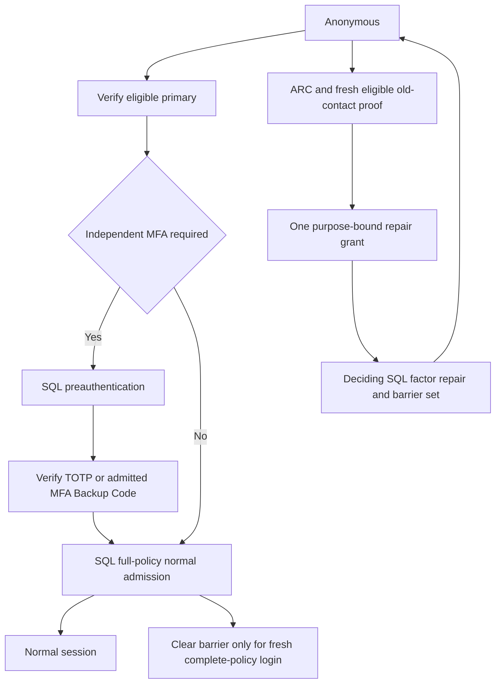

# Authentication and Recovery Policy

## Authority and Status

Owner-confirmed target direction, documented 2026-11-24. This is normative **Hatef
product policy**, not a description of completed implementation or a compliance
certificate. The [ADR](adr/0001-authentication-recovery-and-security-state-authority.md)
remains Proposed pending approval of the delivered architecture. Application work
requires separate owner authorization. Current-source conflicts are recorded in
the [assessment](security-architecture-assessment.md); execution and observed
acceptance belong in the [backlog](../.github/tasks/registration-single-contract-tasks.md)
and [readiness gates](security-testing-and-readiness.md).

This policy governs human authentication and factor repair. OAuth `CLIENT`
workload principals use separately admitted client credentials and permissions.
A UUID-shaped client ID is not a human account, and consumer recovery must never
create, resolve or authenticate a human from that identifier. No hypothetical
username-less account lane, T12 username claim, duplicate authentication service
or registration-v2 implementation is authorized. `/register` remains the public
registration route. `/recover-account` is exclusively deletion cancellation and
reclamation, not lost-factor repair.

## Glossary

| Term                        | Meaning and Exclusions                                                                                                                                                                                                   |
| --------------------------- | ------------------------------------------------------------------------------------------------------------------------------------------------------------------------------------------------------------------------ |
| Identification              | Selection of an account using its immutable username, explicitly selected eligible primary email, or a discoverable credential. Selection is not ownership proof. Mobile is not a login identifier.                      |
| Primary                     | An eligible pre-enrolled password or server-verified passkey assertion. Contact OTP, ARC and MFA Backup Code are not primary methods.                                                                                    |
| Actual UV                   | The verified assertion's user-verification flag, with valid challenge, signature, RP ID, origin and account binding. UP, inventory, browser capability and new-device enrollment UV are not old-factor ownership.        |
| Independent MFA             | Additional policy-required evidence, TOTP or an admitted MFA Backup Code, after an eligible primary. It remains mandatory after primary UV.                                                                              |
| MFA Backup Code             | A saved one-use look-up secret which completes primary-bound independent MFA where policy permits. It does not grant factor-repair authority.                                                                            |
| Account Recovery Code (ARC) | A separately issued saved one-use secret which, with fresh eligible old-contact proof, can earn one restricted factor repair for an ordinary account. It never completes MFA or issues a normal session.                 |
| Old Contact                 | The already verified, currently associated destination recorded before the repair ceremony. New contact proof cannot stand in for old ownership.                                                                         |
| Recovery-Eligible Contact   | An old verified email/mobile destination with authoritative provenance, no relevant revocation, and completed cooldown, or an initial-registration verification exemption.                                               |
| Preauthentication           | SQL-recorded primary evidence awaiting independent MFA and complete policy admission. It has no normal portal, OAuth, administrative or mutation authority.                                                              |
| Repair Grant                | A purpose-, account-, browser-key-, factor- and version-bound one-use authorization to repair exactly one named factor. It is not a normal session or general Step-up.                                                   |
| Repair Barrier              | Durable per-account state prohibiting another repair or equivalent factor-changing bypass until a subsequent fresh complete-policy normal authentication is SQL-recorded.                                                |
| Privileged Account          | An administrator or privileged operator subject to verified hardware-backed phishing-resistant UV and separately enrolled independent backup requirements. Unapproved future assurance categories are not invented here. |
| Hardware-Backed             | An authenticator property verified under an approved provenance/attestation/admission policy. UV, AAGUID, transport, device-bound labeling and backup flags alone do not establish it.                                   |
| Reconciliation              | Read-only reporting of a committed, absent or unknown result. It never restores a consumed proof, renews a deadline or reissues earned authority.                                                                        |

## Stable Invariants

| ID    | Requirement                                                                                                                                                                                                                                                              | Primary Owners                                    |
| ----- | ------------------------------------------------------------------------------------------------------------------------------------------------------------------------------------------------------------------------------------------------------------------------ | ------------------------------------------------- |
| SEC01 | Every production human owns one mandatory immutable username and at least one verified contact. Email identification is intentional and requires the current verified uniquely associated primary email. No fabricated mailbox, empty-email digest or implicit fallback. | T01, T03/T04, T13/T14, T18A, T27A, T31            |
| SEC02 | Normal authentication requires an eligible password or passkey; every passkey authentication verifies actual UV. Contact codes alone never issue normal authority.                                                                                                       | T16A, T18, T20, T31                               |
| SEC03 | Enabled/required independent MFA follows primary authentication even after UV. Record actual UV, actual TOTP and consumed backup separately and preserve original authentication time.                                                                                   | T16A, T21A, T28B                                  |
| SEC04 | Privileged admission verifies hardware-backed phishing-resistant UV and an independently enrolled backup. No consumer ARC recovery, backup-code downgrade, support override or administrative bypass. Total loss remains blocked.                                        | T17A, T28/T29, T42C                               |
| SEC05 | MFA Backup Codes and ARCs have distinct purposes, domains, generations and issuance authority. Neither automatically authorizes the other. ARCs never travel by email/SMS.                                                                                               | T28A/T28B/T28C                                    |
| SEC06 | An ordinary repair requires one ARC and fresh eligible old-contact ownership proof; TOTP replacement also requires an eligible pre-existing primary. Exactly one repair, no ambient normal authority.                                                                    | T28C, T29                                         |
| SEC07 | Successful repair atomically sets a durable anti-chaining barrier. Only subsequent fresh normal authentication satisfying the entire authoritative policy clears it. Alternate factor-management paths cannot downgrade or bypass it.                                    | T16A, T21A, T23A, T24, T25, T26, T29A, T29B, T29C |
| SEC08 | Added/replaced verified contacts have an absolute 24-hour recovery cooldown; initial registration is exempt. Preserve provenance/history, protect the last eligible destination and fence in-flight authority on relevant changes.                                       | T27A, T28C, T41C                                  |
| SEC09 | Primary PostgreSQL decides earned evidence, sessions, proofs, replay, policy, versions, credentials and barriers. Redis is non-authoritative; loss/corruption cannot grant authority or silently remove critical abuse limits.                                           | T16A, T19A, T21A, T42A/T42D                       |
| SEC10 | Applicable authority consumption, account mutation, versions, barrier and audit/notification intent share one deciding SQL transaction with final bound checks after lock waits. Use one documented global lock order.                                                   | T22A, T28-T33, T40B/T41A                          |
| SEC11 | Unknown SQL/provider outcomes do not justify automatic replay, new sessions, restored proofs or recreated accounts. Reconciliation reports facts only.                                                                                                                   | T19A, T28-T33, T41A                               |
| SEC12 | Preserve 30-day deletion grace, legal holds, immutable exact deadlines, username reservation and required reclaim factors. No recovery-grant reuse for deletion. Password/mobile-only activation and T27 retirement require a verified complete lifecycle.               | T27, T30, T41C                                    |
| SEC13 | Extend one registration service. Account/private attributes/username/proofs/credentials/legal evidence commit atomically. Only a known fresh successful birth may issue the expected-subject session to the same browser key.                                            | T31-T37                                           |
| SEC14 | Preserve exact same-snapshot private revisions, privacy grants/statuses, optional protobuf email presence, nullable stable account audit attribution, metadata-only events and existing signed/queued reader contracts.                                                  | T15, T40/T41                                      |
| SEC15 | Browser presentation does not grant authority. Explicit delivery/native actions, stable providers/keys/ceremonies, absolute deadlines, exact secret bytes and typed complete bilingual accessibility contracts survive preferences/navigation.                           | T34-T39                                           |
| SEC16 | Token/IdP/consumer authority and security-state failover/restore need separately verified prerequisites. Restored state cannot resurrect spent or revoked authority; no claimed AAL/FAL/conformity without evidence.                                                     | T42A-T42D, T42                                    |

## Admission Matrix

The following composition rules are exhaustive: apply account status and authoritative
category first, then the operation's evidence requirements. Any missing, unverified,
expired, revoked, spent, cancelled, cross-account, cross-purpose, stale-version or
unknown fact produces denial or bounded uncertainty, never fallback. A stronger
operation-specific policy still applies; the matrix is not a universal Step-up grant.

| Account and Factors                          | Contact State                                                          | Evidence / Operation                                                                                       | Result                                                                                                                                                        |
| -------------------------------------------- | ---------------------------------------------------------------------- | ---------------------------------------------------------------------------------------------------------- | ------------------------------------------------------------------------------------------------------------------------------------------------------------- |
| Ordinary password-only, no required MFA      | At least one verified contact                                          | Fresh eligible password / login                                                                            | Normal session after deciding SQL admission; may clear a prior repair barrier.                                                                                |
| Ordinary passkey-only, no required MFA       | At least one verified contact                                          | Valid pre-existing passkey assertion with actual UV / login                                                | Normal session; enrollment UV alone is denied.                                                                                                                |
| Ordinary password+passkey, no required MFA   | At least one verified contact                                          | Either eligible primary; passkey requires UV / login                                                       | Normal session after policy check; `both` registration still requires both selected credentials at birth.                                                     |
| Ordinary, independent MFA enabled/required   | At least one verified contact                                          | Eligible password or actual-UV passkey only / login                                                        | Preauthentication only, including a repaired password. No normal session or barrier reset.                                                                    |
| Ordinary, independent MFA enabled/required   | At least one verified contact                                          | Primary-bound preauthentication + valid TOTP / completion                                                  | Normal session, actual TOTP recorded; durable one-winner replay check.                                                                                        |
| Ordinary, independent MFA enabled/required   | At least one verified contact                                          | Primary-bound preauthentication + policy-admitted MFA Backup Code / completion                             | Normal session, backup consumption recorded and actual TOTP remains false.                                                                                    |
| Any human                                    | Any contact                                                            | Email/SMS OTP alone, backup alone, ARC alone / login                                                       | Deny normal/preauthentication authority; contact proof and codes retain only their explicit purpose.                                                          |
| Ordinary password-only, no required MFA      | Eligible old contact                                                   | Fresh password + fresh old-contact proof / ARC issuance                                                    | Dedicated fresh password-and-contact issuance purpose; transient viewer only, not an AAL2 claim or general Step-up.                                           |
| Ordinary with required MFA                   | Eligible old contact                                                   | Fresh full-policy authentication + purpose-bound issuance proof / code issuance                            | Issue admitted family only; no recovery grant or stale session substitution.                                                                                  |
| Ordinary with passkey, no required MFA       | Eligible old contact                                                   | Fresh actual-UV primary + dedicated issuance proof / code issuance                                         | ARC issuance can be admitted; backup issuance cannot invent an independent MFA enrollment.                                                                    |
| Ordinary, barrier clear                      | Eligible old contact                                                   | ARC + fresh old-contact proof / password or one-passkey repair                                             | One restricted repair grant; new passkey binding must have UV; no normal session issued.                                                                      |
| Ordinary, barrier clear, TOTP lost           | Eligible old contact                                                   | ARC + fresh old-contact proof + eligible pre-existing primary / TOTP replacement                           | Restricted verified atomic replacement; old TOTP stays active until deciding commit.                                                                          |
| Ordinary, primary and required MFA both lost | Eligible old contact                                                   | ARC + contact but no pre-existing primary for TOTP replacement                                             | Cannot chain primary repair into TOTP replacement. Fail closed unless a subsequent normal login can independently satisfy required MFA.                       |
| Ordinary, barrier set                        | Any contact                                                            | Another ARC, new challenge, regenerated pool, contact OTP, refresh or pre-repair session / factor mutation | Deny recovery and equivalent credential/MFA-management bypass; none clears the barrier.                                                                       |
| Ordinary, barrier set                        | Verified contact                                                       | Newly repaired password, account remains password-only / genuinely fresh login                             | May clear barrier in the normal-login deciding SQL transaction, because the entire unchanged authoritative policy is satisfied.                               |
| Ordinary, barrier set, required MFA          | Verified contact                                                       | Repaired primary + surviving TOTP or eligible backup / genuinely fresh login                               | May clear barrier only after complete policy; backup is not recorded as TOTP.                                                                                 |
| Ordinary                                     | Added/replaced contact younger than 24h, or unknown provenance         | ARC + ownership proof of that contact / recovery                                                           | Deny recovery eligibility. An unchanged eligible old contact may still be used.                                                                               |
| Ordinary                                     | Initial-registration verified contact                                  | ARC + fresh ownership proof / later repair                                                                 | Cooldown exemption applies only to recorded initial verification, not subsequent replacement/re-addition.                                                     |
| Any human                                    | Last recovery-eligible destination                                     | Remove/replace before another destination becomes eligible                                                 | Deny removal which destroys the last eligible destination; add, verify and wait first. Keep T27's current broader email-removal gate until lifecycle release. |
| Privileged                                   | Verified contact, verified hardware UV and independent backup enrolled | Fresh admitted hardware UV + required independent evidence / login or privileged operation                 | Validate authoritative policy and use-boundary evidence; role/inventory alone is insufficient.                                                                |
| Privileged / higher-assurance                | Any contact                                                            | Consumer ARC recovery, backup-code downgrade, support/admin override, total loss                           | Deny. Separately approved higher-assurance recovery procedure does not exist in this scope.                                                                   |
| Pending deletion                             | Retained eligible reclaim factors                                      | Existing stronger bound deletion-cancellation/reclamation procedure within original deadline               | Reclaim state only, no normal session; password/mobile support is planned and must be independently verified.                                                 |
| Suspended/banned/ineligible/deadline passed  | Any contact                                                            | Otherwise valid primary, code or grant                                                                     | Deny under current account policy; no factor can erase a status restriction or legal hold.                                                                    |
| OAuth `CLIENT` workload                      | Not a human contact model                                              | Admitted client credential / workload token                                                                | Separate client authority only; no human portal, consumer MFA/recovery or fabricated user subject.                                                            |

An eligible surviving primary may authenticate normally instead of invoking recovery.
Multiple primaries do not imply that both are required at every ordinary login;
independent MFA is a separate policy requirement. Required MFA cannot be disabled,
removed or reclassified during repair to make the repaired primary sufficient.
Known valid evidence of one factor is never upgraded to evidence of another.

## Authentication and Recovery States

All following state transitions are planned SQL-authoritative behavior. A browser
proof binds continuity and request intent, not factor ownership. Normal sessions
carry separate primary method/credential, primary verification time, actual UV,
actual TOTP/time-step, consumed backup reference, full-policy completion time,
original `auth_time`, account/security/policy version, JKT, absolute expiry and
revocation state. Credentials and code references in diagnostics are minimized;
raw codes/passwords/contact payloads are never evidence artifacts.

There is one ten-minute absolute recovery ceremony, not a fresh ten minutes at
each stage. A repair grant lasts at most five minutes and never beyond the
original ceremony deadline; preserve any existing tighter bound. Native enrollment,
contact resend, challenge creation, navigation, locale/calendar/zone change and
restart cannot extend it. Saved code longevity is separate from these short-lived
grants and from the transient secret viewer. Secrets shown once are not recoverable
by result lookup, browser storage or a delivery retry.

## One Repair and Barrier Reset

At grant admission record old-factor provenance, destination association/provenance,
code family/generation, targeted factor, JKT, account/security/policy versions,
original ceremony deadline and relevant session/evidence IDs. At repair commit
recheck all of them using primary SQL after acquiring locks and waiting. Consuming
the grant, factor mutation, code/epoch consequences, barrier set, session/proof
fences and audit/notification intent form one deciding transaction.

Password repair updates one password; one-passkey repair adds/replaces the exact
approved credential while retaining unrelated uncompromised credentials. TOTP
replacement stages a new secret without deactivating the old one, verifies the
new TOTP and its durable replay claim, and swaps atomically. A cancelled, expired
or unknown enrollment cannot deactivate the old TOTP. A repaired primary is not
pre-existing independent surviving evidence for a second repair.

The barrier is per account, not browser/cache/grant. Replicas, process restarts,
new challenges, pool regeneration and alternate password/passkey/MFA management
endpoints must consult it. While set, factor-changing bypasses and MFA-policy
downgrades are denied. Time, possession of additional ARCs, contact OTP, refresh
and sessions authenticated before the repair do not clear it. Only a fresh normal
login whose SQL-recorded evidence satisfies the entire authoritative policy may
clear it atomically with admission. A repaired password is sufficient for an
ordinary password-only account, but only preauthentication where MFA is required.
Multi-factor loss without sufficient surviving evidence is deliberate lockout,
not permission for support to invent a fallback.

## Contact Provenance and Cooldown

Store contact association/verification IDs, original association and verified UTC
times, replacement/removal history, initial-registration exemption, security
version and computed absolute `recovery_eligible_at`. Added/replaced contacts
become eligible no earlier than 24 hours after their authoritative verification.
Unknown history is ineligible, never treated as registration provenance. A removed
association is not eligible merely because its old address was once verified;
re-addition must receive a new association and cannot use old eligibility. Reverification
does not reset an existing restriction or make the destination immediately eligible.
Preference/time-zone changes affect display only. Preserve an unchanged eligible
destination, and invalidate relevant pending challenges/grants when an association
or policy changes. Last eligible destination removal remains blocked until an
alternative is verified and eligible. The current broader T27 primary-email safety
gate is retired only by the independently observed complete-lifecycle gate.

## Code Lifecycle

Proposed Hatef choice: generate at least 128 independent random bits per saved
code using a CSPRNG. Store purpose/account/family-generation-bound HMAC-SHA-256
verifiers with separate family domains and a dedicated versioned key held outside
the database. Domain encoding must be unambiguous and validated with cross-purpose
test vectors. Use constant-time application comparisons where applicable; indexed
SQL lookup is not claimed constant-time. Argon2id remains for passwords, not these
high-entropy codes. Existing SHA-256 high-entropy verifiers are not inherently
insecure; HMAC is a stronger database-read-compromise defense, not a universal
NIST requirement or protection against combined application/key/SQL compromise.

| Event                                          | Saved Codes                                                                                                                                 | Derived Evidence / Sessions                                                                                                       | Barrier                                                                          |
| ---------------------------------------------- | ------------------------------------------------------------------------------------------------------------------------------------------- | --------------------------------------------------------------------------------------------------------------------------------- | -------------------------------------------------------------------------------- |
| Single successful MFA Backup Code use          | Consume exactly that backup, not an ARC                                                                                                     | Complete only its primary-bound preauthentication; no repair grant                                                                | Does not clear except as part of genuinely fresh full-policy login               |
| ARC earns repair authorization                 | Consume exactly that ARC in the SQL grant-admission transaction; lost response cannot restore it                                            | One grant, targeted purpose, original deadline; receipt cannot reissue it                                                         | Admission requires clear barrier; successful repair sets it                      |
| Regenerate/revoke one family                   | Increment that family generation, revoke all its unspent artifacts                                                                          | Invalidate all derived outstanding grants/challenges of that family; no implicit new session                                      | Never reset                                                                      |
| Ordinary password change or passkey add/remove | Retain unrelated uncompromised saved codes only while account/family policy remains eligible                                                | Increment security version; invalidate stale bound sessions/preauth/proofs/repair grants, including cross-family derived evidence | Management cannot bypass a set barrier                                           |
| TOTP enable/verified replacement/removal       | Revoke MFA Backup Code generation; fresh authorized issuance required. Retain unspent ARCs unless independently compromised/ineligible      | Fence old MFA/preauth/replay generations and stale repair evidence                                                                | Replacement by recovery sets barrier; required MFA cannot be removed to clear it |
| Privilege or admitted-assurance change         | Revoke both saved consumer families and require fresh permitted issuance; promotion denies consumer ARC and downgrade backup                | Revalidate admitted hardware/backup and revoke stale category/session/token authority                                             | Never reset or weaken required evidence                                          |
| Deletion request                               | Revoke both saved families and their derived authority                                                                                      | Revoke normal/preauth/repair authority; preserve required reclaim factors and immutable queued work                               | Preserve state through cancellation; cancellation is not fresh login             |
| Confirmed compromise                           | Revoke implicated credentials/families; revoke both code families if pool/application custody was compromised                               | Fence impacted authority and require approved incident handling                                                                   | Never reset by incident cleanup                                                  |
| Key rotation / custody loss                    | No transparent reinterpretation; verify approved inventory and admitted key version, revoke affected artifacts if custody cannot be trusted | Deny unknown-version verification; no restored proofs                                                                             | Preserve                                                                         |

Saved codes have no routine time-based expiry: usable until single use, generation
revocation/regeneration, deletion or policy ineligibility. A clear code inventory
does not override a set barrier. Replacement batches always require their own
fresh issuance purpose and full applicable policy; never issue from a repair grant,
reconciliation result or automatic contact delivery. The transient ARC viewer has
bounded no-store lifetime and explicit Copy/Download only, with independently
protected offline storage encouraged. MFA Backup Codes are shown through an
equally explicit authorized secure viewer, not conflated with an emailed OTP.

Existing untyped `recovery_codes` require a concrete stored-artifact/reader/consumer
inventory and owner-approved handling before new writers activate. Do not treat
one existing code as both purposes, silently delete real artifacts or add a
speculative historical-user migration. Preserving real readers and queued work
is a verified dependency, not a hypothetical legacy authentication lane.

## SQL Authority and Failure Semantics

Primary SQL owns security facts and final admission. Redis may accelerate lookup,
coordinate delivery/rate limits and reject earlier, but cannot grant normal or
preauthentication authority, prove TOTP unseen, clear a barrier or recreate a
consumption result. Critical security admission has durable enforcement or a
fail-closed outage policy. Redis loss, forged records, flush and failover must
not silently permit more attempts. SQL unavailability denies new authority.

The proposed global lock order is: applicable global username/security-policy
guards; existing ledger coordination where required; account advisory locks in
UUID order; user rows in UUID order; then operation rows in this suborder:
session/evidence/preauthentication, contact association, code family/code,
action/repair/ceremony proof, credential/MFA/replay, hold/lifecycle; then transactional
outbox/audit-notification intent writes. Sort keys within each class and never
acquire an earlier class late.
The [data design](data-architecture.md) specifies the concrete row/guard inventory
and reconciles existing services before implementation approval. Hashing, provider
delivery and native authenticator work stay outside long-held locks; recheck their
bound results under locks. Multiple account/global operations require explicit
ordering tests, not a claim that an advisory lock alone proves all races safe.

Unknown commit is not rollback evidence. An ARC/proof consumed before a lost
response is not re-created; a read-only result can report known committed outcome
without returning the secret or issuing authority. A new, explicitly authorized
ceremony requires new evidence and cannot bypass the account barrier. External
provider acceptance/delivery uncertainty has separate status and stable message
identity. PostgreSQL and Redis are not one atomic transaction.

## Notifications, Deletion and Privacy

Define metadata-only security-event contracts and compatible readers before new
security-changing writers, then enqueue applicable intents in the deciding SQL
transaction. Required events include code-family issuance/regeneration/revocation,
MFA backup use, ARC grant/repair result, password/passkey/TOTP changes, contact
association/cooldown changes, privilege changes, normal authority/revocation and
deletion/cancellation/purge. Security notifications cover code-family changes,
backup use, factor repairs, contact/role changes and deletion lifecycle according
to approved verified-destination eligibility. Do not expose raw codes, factor
secrets, recipient PII, repair grants or private profile data in events or logs.

| Lifecycle                   | Destination and Intent Rule                                                                                                                                                         |
| --------------------------- | ----------------------------------------------------------------------------------------------------------------------------------------------------------------------------------- |
| Ordinary factor/code change | Snapshot eligible existing verified recipients, template/version/locale and metadata intent; notify old destinations on contact replacement where permitted. Never mail/SMS an ARC. |
| Restricted repair           | Capture security notification intent atomically with repair, without making accepted delivery a normal-login credential.                                                            |
| Deletion/cancellation       | Retain exact 30-day deadline, existing stronger authorization, recipient/token binding and reclaim factors; ARC/backup/repair grants are inadmissible.                              |
| Mobile-only lifecycle       | Must have verified SMS notification, password/passkey-appropriate deletion and reclaim, incident behavior and actual receipt evidence before enablement.                            |
| Queued work                 | Preserve original recipient, token, locale, encryption/template version and deadline across retries/rollback; compatible v1/v2 readers precede writers.                             |

Queued, provider-accepted, delivered, permanent failure and unknown are distinct
statuses. No exactly-once external delivery claim. Existing audit formats and
stable nullable `account_ref` attribution remain; absence of email is represented
truthfully, not by an empty-email digest. Private attributes remain encrypted and
released only under exact grants/snapshot revision. Username reservation survives
deletion through required surviving rows. Holds and security-ledger retention are
independent of the 30-day grace; no recovery procedure removes them.

## Standards Applicability

Official status retrieval date: 2026-11-24. Standard SHALL/MUST requirements apply
only within the referenced scope and chosen conformity profile. The SEC invariants
are Hatef requirements; stronger or different product decisions are not attributed
to a standard. This review establishes no AAL, FAL, ASVS, FIDO certification or
verified identity-proofing claim. Exact official status/errata evidence is recorded
in [readiness](security-testing-and-readiness.md#standards-evidence).

| Reference                                                                                                                                                                                                                                     | Version / Status                            | Relevant Scope and Evidence Gap                                                                                                                                                                                                                                            |
| --------------------------------------------------------------------------------------------------------------------------------------------------------------------------------------------------------------------------------------------- | ------------------------------------------- | -------------------------------------------------------------------------------------------------------------------------------------------------------------------------------------------------------------------------------------------------------------------------- |
| [NIST SP 800-63B-4](https://pages.nist.gov/800-63-4/sp800-63b.html)                                                                                                                                                                           | Final, July 2025                            | Sections 2-5: authentication factors, replay/rate limits, binding, recovery and session management. Recovery evidence does not itself create an authenticated AAL session.                                                                                                 |
| [NIST SP 800-63C-4](https://pages.nist.gov/800-63-4/sp800-63c.html)                                                                                                                                                                           | Final, July 2025                            | Federation assertions, `(iss, sub)`, trust agreements and RP validation. Missing consumer admission/IdP paths preclude FAL claims.                                                                                                                                         |
| [OWASP ASVS](https://github.com/OWASP/ASVS/tree/v5.0.0/5.0/en)                                                                                                                                                                                | Pinned 5.0.0, stable May 2025, L1-L3        | V6 authentication, V7 sessions, V8 authorization, V10 OAuth/OIDC and V14/V16 privacy/audit. No Level 4. Product contact verification/private attributes do not prove identity proofing; optional MFA/password-only flows require an explicit applicability gap assessment. |
| [WebAuthn Level 3](https://www.w3.org/TR/2026/REC-webauthn-3-20260825/)                                                                                                                                                                       | W3C Recommendation, 25 August 2026          | Sections 7.1/7.2 verifying registration/assertions, 13.4/14.6 security/enumeration. UV, sync, attestation, hardware and independent backup are distinct.                                                                                                                   |
| [RFC 9700](https://www.rfc-editor.org/info/rfc9700)                                                                                                                                                                                           | BCP 240, January 2025                       | OAuth security BCP, client/redirect/code/token protections. PKCE does not substitute for confidential-client authentication.                                                                                                                                               |
| [RFC 9449](https://www.rfc-editor.org/info/rfc9449)                                                                                                                                                                                           | Proposed Standard, September 2023           | OAuth access-token DPoP proof and key binding. Cookie plus browser-key proof is a Hatef profile, not automatically conformant access-token DPoP; XSS can invoke a non-exportable key.                                                                                      |
| [RFC 10017](https://www.rfc-editor.org/info/rfc10017)                                                                                                                                                                                         | BCP 212, August 2026                        | OAuth browser-client threats/patterns. Same-domain cookie applications have a scoped distinction; this does not authorize changing the existing browser architecture.                                                                                                      |
| [RFC 6238](https://www.rfc-editor.org/info/rfc6238) / [RFC 4226](https://www.rfc-editor.org/info/rfc4226)                                                                                                                                     | Informational, May 2011 / December 2005     | TOTP/HOTP algorithms; correct algorithm alone does not prove replay-safe admission, recovery or MFA independence.                                                                                                                                                          |
| [OIDC Core](https://openid.net/specs/openid-connect-core-1_0-errata2.html)                                                                                                                                                                    | 1.0 approved errata set 2, 15 December 2023 | Authorization, consent, issuer/subject and token validation; interactive completion is a prerequisite, not certified here.                                                                                                                                                 |
| [OAuth 2.1](https://datatracker.ietf.org/doc/draft-ietf-oauth-v2-1/)                                                                                                                                                                          | Active draft-17, October 2026               | Work in progress, not a final standard. Published OAuth BCPs remain the active security references.                                                                                                                                                                        |
| [OWASP cheat sheets](https://cheatsheetseries.owasp.org/), [FIDO recovery guidance](https://fidoalliance.org/recommended-account-recovery-practices/), [passkey types](https://www.passkeycentral.org/introduction-to-passkeys/passkey-types) | Continuously updated nonbinding guidance    | Practical authentication/recovery/threat controls, not certification or proof of a deployed authenticator property.                                                                                                                                                        |

NIST distinguishes saved recovery codes, issued recovery codes and recovery
contacts from ordinary authentication. Hatef ARC+fresh-old-contact is a proposed
saved-plus-issued/contact-proof recovery combination, not email MFA, phishing
resistance or automatic AAL2 admission. Independence and channel enrollment must
be assessed; storing ARC and mailbox credentials in the same compromised vault
can defeat both proofs. At least 128-bit codes exceed cited minimum entropy, but
do not cure correlated compromise or missing issuance authority. NIST look-up
secret online issuance requires AAL2 or higher, and its examples overlap saved
recovery codes. A password-only ARC issuance path has an unresolved applicability
gap too; purpose separation alone does not waive that requirement. It must not be
advertised as conformant AAL2 issuance of either family. Saved-code single-use
replacement requirements also need mapping to Hatef's independently authorized
replacement batch, not automatic contact delivery or renewed repair authority.

NIST B-4 sections 4.2.1.2 and 4.6 require support for at least two recovery and
notification addresses in their applicable profile; Hatef's at-least-one verified
contact production rule alone does not meet that requirement. ASVS 5.0.0-6.3.3
MFA/hardware, 6.4.3 reset not bypassing MFA, 6.4.4 lost-MFA identity proofing and
6.5.5 TOTP maximum lifetime need explicit evidence/gap mapping. Self-asserted
private attributes/contact verification are not identity proofing. These gaps
remain explicit without expanding the owner-confirmed product requirements.

Passwords retain the exact-byte current contract: no trim, normalization, substring
verification or localization mutation. NIST's Unicode NFC SHOULD recommendation
is a documented divergence, not falsely reported as a SHALL violation or blanket
conformity. Password-length/blocklist/cost/profile and lookup-secret binding
requirements need specific assessment before any NIST/ASVS claim. A privileged
Hatef label alone does not establish NIST AAL3, validated cryptographic modules,
attestation provenance, backup independence or an RP's FAL responsibilities.
