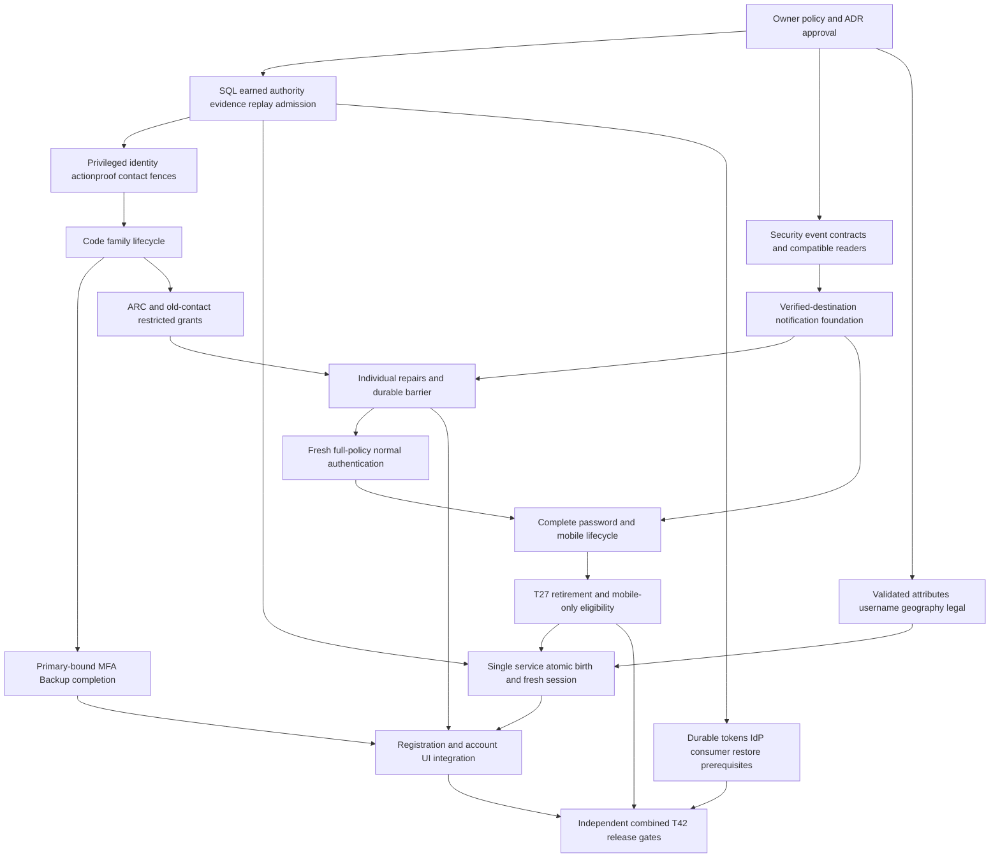

# Documentation Alignment Report

## Delivery and Authorization

2026-11-24 documentation/backlog execution of the owner-provided Hatef Identity
Security Architecture plan. This report covers A-K below. Application code, tests,
configuration, migrations, database/provider operations, deployment, dependency
manifests/Nx targets, historical plans/`tasks.md` and Git mutations are excluded.
No application task was completed, no runtime pass is claimed, and implementation
remains blocked pending explicit owner approval of the delivered architecture,
documents and revised backlog followed by separate bounded implementation approval.

Refreshed HEAD: `85abb13a27196c229efa7f59d7ef5beebb1d7e49`; initial working tree
clean. Planning HEAD `f9d2119ff15927d382d860b7f62584682c5b5f31` is unavailable, so
the assessment re-inspected current source instead of claiming unchanged findings.
The canonical `.github/tasks/registration-single-contract-tasks.md` was absent;
the existing T01-T42 backlog was found and fully read. Its
[published historical snapshot](history/registration-backlog-2026-11-23.md)
preserves the complete definitions and acceptance narratives. The
[original architecture execution plan](history/security-architecture-plan-2026-11-24.md)
is also published as superseded history. Neither archive is an executable task
source or current policy. The canonical backlog preserves historical definitions
and dated evidence with supersession labels; `tasks.md` remains unchanged.

The owner subsequently authorized removing local-document dependencies and making
the checks reproducible. That follow-up publishes only the two reviewed archives,
a repository-owned documentation checker and its tests, and scoped crosslinks.
It does not publish private agent settings or raw artifacts, change runtime
behavior, activate an application task, alter CI/targets/manifests or authorize
deployment. Required code-task regression gates apply to the checker/test changes.

## A-K Deliverables

| Deliverable                            | Authoritative Location                                                                                                                                                                  | Result / Boundary                                                                                                                                                                                |
| -------------------------------------- | --------------------------------------------------------------------------------------------------------------------------------------------------------------------------------------- | ------------------------------------------------------------------------------------------------------------------------------------------------------------------------------------------------ |
| A Current architecture assessment      | [Assessment](security-architecture-assessment.md)                                                                                                                                       | Current-source strengths and twelve classified findings with exact paths/ranges; static inspection only.                                                                                         |
| B Authentication/recovery target       | [Policy](authentication-and-recovery-policy.md)                                                                                                                                         | Owner-confirmed SEC01-SEC16, categories/identifiers/factors, code families and restricted authority.                                                                                             |
| C Evidence/operation/result model      | [Policy admission matrix](authentication-and-recovery-policy.md#admission-matrix) and state/lifecycle sections                                                                          | Explicit allow/preauth/restricted/deny/unknown outcomes, unavailable-factor and provenance cases, full-policy barrier reset.                                                                     |
| D Decisions/aligned design             | [ADR](adr/0001-authentication-recovery-and-security-state-authority.md), architecture/API/data/registration and scoped guides                                                           | One Proposed ADR, current-versus-planned designs and trade-offs; owner approval pending.                                                                                                         |
| E Revised tasks/dependencies           | [Canonical backlog](../.github/tasks/registration-single-contract-tasks.md)                                                                                                             | All primary T01-T42 retained: 64 executable records, six aggregate aliases and excluded T12 (71 IDs); fifteen sections each and 512 stable acceptance criteria, no fabricated target completion. |
| F Threat model                         | [STRIDE matrix](threat-modeling.md#authoritative-stride-matrix)                                                                                                                         | Preconditions/assets/current controls/gaps/mitigations/residual risks/invariants/tasks/evidence for all requested threat classes.                                                                |
| G Implementation conflicts/remediation | [F01-F12 assessment](security-architecture-assessment.md#findings) and task/invariant owners                                                                                            | Source-proven conditional findings distinct from missing prerequisites and safety gates; no dynamic exploit claim.                                                                               |
| H Testing/release readiness            | [Readiness test matrix](security-testing-and-readiness.md#required-test-matrix) and release gates                                                                                       | Twenty-three future test groups; independent/manual/platform/provider/deployed gates separate, current target remains blocked.                                                                   |
| I Standards/operations applicability   | [Policy standards](authentication-and-recovery-policy.md#standards-applicability), [standards evidence](security-testing-and-readiness.md#standards-evidence), operations/DR/governance | Verified versions/status/official references, explicit conformity gaps and nonbinding guidance, SQL/Redis/restore and lifecycle requirements.                                                    |
| J Consistency/traceability             | This report, authority map and contradiction table                                                                                                                                      | Every scoped guide reviewed, active contradictions corrected and preserved history/supersessions recorded.                                                                                       |
| K Inventory/validation/delivery        | This report and [documentation evidence](security-testing-and-readiness.md#this-documentation-pass)                                                                                     | Exact changed/reviewed inventory and actual format/path/anchor/task/command/Mermaid checks; no runtime or production approval.                                                                   |

## Authority Map

| Subject                                            | Owner                                          | Other Documents' Responsibility                                                                                            |
| -------------------------------------------------- | ---------------------------------------------- | -------------------------------------------------------------------------------------------------------------------------- |
| Target policy/glossary/SEC IDs                     | Authentication and recovery policy             | Crosslink and apply requirements; do not invent weaker fallback or duplicate policy.                                       |
| Current source/findings/F IDs                      | Security architecture assessment               | Scoped behavior must agree with current inspected source and its limitations.                                              |
| Decision/alternatives                              | Proposed ADR 0001                              | Preserve approval status and separate implementation authorization.                                                        |
| Executable task/criterion/dependency IDs           | Canonical backlog                              | Historical aliases resolve without relabeling old delivery as new policy compliance.                                       |
| STRIDE threat/control/residual evidence            | Threat modeling                                | Link required tests and unresolved threat evidence; current controls not target completion.                                |
| Tests/launch/source-bound evidence                 | Security testing and readiness                 | Distinguish future required gates from historical/local/deployed observations.                                             |
| Installed migrations/configuration                 | DevOps operations canonical packaged inventory | Admin/container/README/data crosslink; packaged source is authority, not copied stale lists.                               |
| Single registration fields/current-target contract | Registration contract under target policy      | Frontend/API/backlog reuse validators and one service; no register-v2.                                                     |
| Bilingual/notification presentation                | Localization                                   | Preserve exact bytes, stable identity, typed English/Persian completeness and immutable queued-reader contracts.           |
| Historical acceptance                              | Original dated guide/backlog records           | Preserve original source/date/toolchain/count/outcome; unavailable artifact paths are labeled historical literal evidence. |

## Modified and New Inventory

All fifteen pre-existing `docs/` Markdown documents and the root README were fully
reviewed. Exactly five new documents and one new canonical backlog are authorized.
No second docs README or extra topic documents were created.

| File                                                                    | Change   | Responsibility / Reason                                                                                                                                           |
| ----------------------------------------------------------------------- | -------- | ----------------------------------------------------------------------------------------------------------------------------------------------------------------- |
| `README.md`                                                             | Modified | Full root navigation, pre-launch/current-target status, actual toolchain, canonical installation links and non-certifying security claims.                        |
| `docs/architecture.md`                                                  | Modified | Mixed current SQL/Redis versus planned authority, evidence/privileged/recovery boundaries, trust diagram and IdP/workload limits.                                 |
| `docs/api-design.md`                                                    | Modified | Accurate current password/contact/MFA/metadata contracts; planned purposes/expiry/SQL evidence/reconciliation separated.                                          |
| `docs/data-architecture.md`                                             | Modified | Proposed earned facts/constraints/generations/replay/barrier/contact history, global lock order, final deciding transaction and restore quarantine.               |
| `docs/threat-modeling.md`                                               | Modified | Authoritative 26-row STRIDE matrix and correction of supplemental guarantees, current gaps and required future evidence.                                          |
| `docs/registration-contract.md`                                         | Modified | One existing registration/current private-data distinction; owner-confirmed target/contact/primary/legal/birth/session requirements and validators retained.      |
| `docs/frontend-pages.md`                                                | Modified | Accurate mounted versus notice/absent pages; distinct normal/MFA-backup/lost-factor/code-management/deletion journeys and explicit native work.                   |
| `docs/localization.md`                                                  | Modified | Code-family terminology and planned bilingual authority/deadline/secret-byte contracts, current queued readers unchanged.                                         |
| `docs/localization-validation.md`                                       | Modified | Historical counts/source/status preserved; new recovery/security and manual bilingual evidence explicitly outstanding.                                            |
| `docs/client-integration.md`                                            | Modified | `(iss, sub)`, separate proof profiles/CLIENT workload, current metadata readers/nullable email and consumer/IdP prerequisites.                                    |
| `docs/admin-operations.md`                                              | Modified | Hardware/independent-backup policy, SQL/role boundaries, consumer-recovery denial and open operational gates, dated acceptance retained.                          |
| `docs/devops-operations.md`                                             | Modified | Canonical eleven packaged migrations/current configuration and eight-suite/thirteen-race inventory, reader-first notifications and SQL/restore/lifecycle rollout. |
| `docs/container-deployment.md`                                          | Modified | Canonical install/configuration links, current signup versus planned selected contact, defaults disabled and ingress/manual gates.                                |
| `docs/disaster-recovery.md`                                             | Modified | No spent/revoked resurrection; primary/failover/security rollback witness and quarantine, actual versus proposed HA.                                              |
| `docs/compliance-and-data-governance.md`                                | Modified | Accurate standards/rights/vendor/retention and nullable attribution/recovery-notification obligations; unsupported conformity claims removed.                     |
| `docs/page-gallery.md`                                                  | Modified | Narrow status/crosslinks only; illustrations not new recovery/hardware acceptance. Tooling/artifacts unchanged.                                                   |
| `docs/authentication-and-recovery-policy.md`                            | New      | Normative consolidated SEC01-SEC16 matrix, deadlines/code lifecycle/cooldown/barrier and standards applicability.                                                 |
| `docs/security-architecture-assessment.md`                              | New      | Refreshed F01-F12 exact source evidence, strengths and operational/consumer prerequisites.                                                                        |
| `docs/security-testing-and-readiness.md`                                | New      | TEST01-TEST23, G01-G13, official status/errata limitations and final evidence requirements.                                                                       |
| `docs/adr/0001-authentication-recovery-and-security-state-authority.md` | New      | Proposed decision and consequences, rejected alternatives, supersessions/approval boundary.                                                                       |
| `docs/documentation-alignment-report.md`                                | New      | This A-K map, inventory/authority/traceability/supersession/validation report.                                                                                    |
| `.github/tasks/registration-single-contract-tasks.md`                   | New      | Canonical revised task backlog based on preserved local T01-T42 definitions and evidence.                                                                         |

Total intended scope: **22 files**, comprising **16 modified and 6 new**. Final
checks include staged, unstaged and untracked documentation. Any external staging
observed during execution is preserved; this session does not stage, unstage,
commit or rewrite Git state. No application/config/test/gallery artifact change
is authorized or counted.

## Reviewed Unchanged

| File / Inventory                                                                            | Reason Kept Unchanged                                                                                             |
| ------------------------------------------------------------------------------------------- | ----------------------------------------------------------------------------------------------------------------- |
| `AGENTS.md`                                                                                 | Repository rules remain unchanged; private execution settings are not shared-document dependencies.               |
| Original local plan/backlog files                                                           | Original files remain untouched; their two reviewed historical snapshots are now published under `docs/history/`. |
| `tasks.md`                                                                                  | Historical Phase 1-7 roadmap and dated acceptance preserved; new target authority is linked from root navigation. |
| `.github/workflows/identity-api.yml`                                                        | Current CI command/toolchain/integration/race and release authority, no weakened gates.                           |
| `.nvmrc`, `package.json`, installed Prettier package                                        | Read to verify actual runtime/version/parser; manifests and lockfile unchanged.                                   |
| `nx.json`, `.prettierrc`, `.prettierignore`                                                 | Read-only workspace/format authority; no targets, configuration or ignore rules changed.                          |
| `nx-workspace`, `nx-run-tasks` and `task-verification` skill sources                        | Read/loaded for project discovery and documentation-only final verification.                                      |
| Assessed `apps/identity-api/internal/`, SQL migrations/queries and relevant tests/contracts | Read-only source evidence listed in assessment, not implementation or test execution.                             |
| Existing gallery/tooling/artifacts                                                          | Out of scope; no generation, browser artifacts or privacy-sensitive outputs created.                              |

No pre-existing document in the requested `docs/` inventory is left unreviewed or
unchanged without explanation; each received scoped alignment. Historical local
plans are not authority for fresh-clone links; their preserved literal evidence
is not a link-validation waiver for active guidance.

## Resolved Contradictions

| Former Active Claim / Gap                                                     | Resolution and Preserved Boundary                                                                                                                                                                                          |
| ----------------------------------------------------------------------------- | -------------------------------------------------------------------------------------------------------------------------------------------------------------------------------------------------------------------------- |
| Legacy email/T12 username claim                                               | Mandatory immutable production username and intentional eligible primary-email identification; T12 excluded. Historical definition retained as explicitly superseded, no hypothetical account lane.                        |
| Recovery code/new-device UV proves old ownership                              | Current conditional factor mutation/takeover documented; target ARC plus fresh eligible old-contact one repair and privileged denial. Recovery never directly issues normal session.                                       |
| Recovery always bypasses enabled TOTP                                         | Current source correction: enabled TOTP still gates normal login. MFA-disabled, including privileged passkey-only, remains conditional takeover risk.                                                                      |
| Primary email required by current deletion payload                            | Current nullable primary/configured backup mailbox behavior recognized; it does not prove verified-destination/mobile/password lifecycle completeness.                                                                     |
| UV replaces independent MFA / backup can set TOTP                             | Separate primary, actual UV, actual TOTP, backup consumption and original authentication time; required independent MFA persists after UV.                                                                                 |
| Privileged role/passkey inventory proves hardware                             | Actual verified hardware provenance plus separately enrolled independent backup required at admission/use, no consumer/support downgrade.                                                                                  |
| Redis disposable yet authority-bearing                                        | Current earned state is explicitly Redis authority; target primary SQL earned facts/replay/limits, no SQL+Redis atomicity or forged-cache fallback.                                                                        |
| Generic fresh Step-up proves all final mutations                              | Exact bound evidence/expiry/session/purpose final deciding-transaction checks required; source-proven recovery/deletion sequencing gaps retained.                                                                          |
| Regeneration/time/repaired primary allows chained loss repair                 | Durable SQL barrier across management endpoints/restarts; only fresh full-policy normal login resets. Repaired password-only qualifies, MFA-required primary-only does not.                                                |
| Immediate new/re-added verified contact recovery                              | 24h absolute provenance cooldown, initial-registration-only exemption, unknown denial and last eligible destination fencing.                                                                                               |
| Email absent automatically means complete lifecycle                           | Current T27 gate retained until recovery/notifications/deletion/reclaim and real receipt independently verified. No fabricated mailbox/empty digest.                                                                       |
| Obsolete migration counts and seven/eight race packages                       | Eleven current packaged migrations under one canonical operations inventory; CI has eight integration suites and thirteen race packages. Historical counts remain dated evidence.                                          |
| UI all English/disconnected or nonexistent OAuth/recovery pages mounted       | Current localized/mounted/notice/absent behavior distinguished; planned normal/MFA-backup/repair journeys not fabricated and `/recover-account` deletion-exclusive.                                                        |
| Private attributes globally standalone and private-profile events future-only | Existing private SQL/API storage and current private-profile v2/email v1 metadata recognized; registration target still missing.                                                                                           |
| Fixed count of 42 executable tasks                                            | Preserve primary IDs and add bounded subtasks/alias inventory. Task families aggregate dependencies, not a misleading unchanged executable count.                                                                          |
| Final OAuth 2.1 / ASVS Level 4 / blanket NIST-AAL-FAL conformity              | OAuth draft-17; ASVS 5.0.0 L1-L3; official standards/gaps and stronger Hatef choices explicitly separated.                                                                                                                 |
| Universal constant-time/O(1)/XSS immunity                                     | Application digest primitives scoped; SQL/content/timing/DoS residuals and XSS use of non-exportable keys acknowledged.                                                                                                    |
| Blanket PII encryption and competing lock suborders                           | Primary email/linkable metadata remain plaintext; envelope encryption diagram is scoped to selected private payloads. Policy and ADR adopt the data design's exact canonical operation-row suborder, not a competing list. |
| Deployed HA/zero-loss/safe restore inferred                                   | No observed HA; stale replica/failover fencing and independent security rollback witness or safe invalidation required. Clearing sessions alone insufficient.                                                              |
| New version/compatibility invented for product rename                         | Real optional email, v1/v2 readers, signed formats, queued bytes and stored untyped artifacts retained; new code-family activation requires concrete inventory/approved handling.                                          |
| Rights/vendor/legal approval inferred from repository                         | Explicit governance/provider/deployed/physical/Persian gates; no compliance or real-source authorization asserted.                                                                                                         |

## Invariant and Task Traceability

| Invariants        | Authoritative and Scoped Documents                    | Task / Required Evidence                                                            |
| ----------------- | ----------------------------------------------------- | ----------------------------------------------------------------------------------- |
| SEC01/SEC13       | Policy, registration, API, data, README               | T01/T03/T04/T13/T14/T18A/T31-T37; TEST01/TEST02/TEST17, F03/F10/F11.                |
| SEC02/SEC03       | Policy, assessment, API, client, frontend             | T16A/T18/T20/T21A/T28B; TEST03/TEST04, F04/F05/F06.                                 |
| SEC04             | Policy/ADR, admin/client/architecture/threat          | T17A/T28/T29/T42C; TEST05/TEST21, G03/G08, F01/F05/F12.                             |
| SEC05/SEC06       | Policy/ADR, API/data/frontend/localization            | T28A/T28B/T28C/T29A-T29C/T38; TEST06-TEST10, F01/F02/F07.                           |
| SEC07/SEC08       | Policy, data/threat/API/operations                    | T16A/T21A/T23A/T24-T26/T29A-T29C/T27A/T41C; TEST11/TEST12/TEST14, F02/F09.          |
| SEC09/SEC10/SEC11 | Data/architecture/assessment/ADR, API/operations/DR   | T16A/T19A/T21A/T22A/T28-T33/T42A/T42D; TEST13-TEST15/TEST22, F02/F06/F08.           |
| SEC12             | Policy, privacy API/frontend/admin/ops/DR/governance  | T27/T30/T41C; TEST16/TEST19, G05, F08/F09.                                          |
| SEC14             | Data/API/client/governance/localization/admin         | T15/T40/T41; TEST18/TEST19, G10/G13, current-reader/nullable/metadata preservation. |
| SEC15             | Frontend/localization/validation/gallery/registration | T34-T39; TEST20, G11/G12/G13, no private artifacts or ceremony replay.              |
| SEC16             | Assessment/readiness/client/ops/DR/ADR/threat         | T42A-T42D/T42; TEST21-TEST23, G06-G09, F12/restore and independent-review gaps.     |

## Dependency and Parallel Boundaries

The canonical backlog is the task DAG authority. This condensed graph explains
release ordering, not implicit authorization to execute dependencies or proof of
implemented prerequisites. Contract/readers foundations break notification/recovery
cycles; T40 private snapshot work is independent of early security-event contracts.

After authority/evidence/event contracts are agreed, code/recovery foundations and
notification infrastructure may run in parallel with disjoint responsibilities.
UI consumes fixed contracts, never invents purposes/deadlines. Security review
checkpoints remain policy/ADR approval; SQL/lock/rollback design; MFA/privileged/
recovery admission; barrier/cooldown; full lifecycle; CP06 registration and
fresh-session authority; CP06b token, interactive OIDC, and privileged-consumer
authority; independent launch review. The future integrating implementation agent owns final
combined uncached verification. Documentation work has not passed these gates.

## Validation Results

### Original Local Pass (2026-11-24)

Documentation-only validation passed on the final combined 22-file scope at the
recorded unchanged HEAD. Evidence-report edits received their own affected
format/reference rechecks. No runtime status is inferred from these results.

| Check                                                                         | Command / Scope                                                                                                                                      | Status                                                                                                                                                                                                                                                                                                                                                                                                                                   |
| ----------------------------------------------------------------------------- | ---------------------------------------------------------------------------------------------------------------------------------------------------- | ---------------------------------------------------------------------------------------------------------------------------------------------------------------------------------------------------------------------------------------------------------------------------------------------------------------------------------------------------------------------------------------------------------------------------------------- |
| Toolchain                                                                     | Local NVM Node v24.18.0/npm 11.21.0; installed Prettier 3.9.5; isolated Mermaid 11.17.2/jsdom 27.4.0/GitHub slugger 2.0.0                            | Passed executable/version checks; Go/linter not run because documentation-only.                                                                                                                                                                                                                                                                                                                                                          |
| Nx/command authority                                                          | `npm exec -- nx show project schemas --json`, `identity-api`, `web`; `nx exec --help`; current workflow read                                         | Passed local target discovery. Nx MCP docs HTTP 500 noted; no guessed target fallback.                                                                                                                                                                                                                                                                                                                                                   |
| Formatting                                                                    | `npm exec -- nx exec -p schemas -- prettier --check "$PWD/README.md" "$PWD/.github/tasks/registration-single-contract-tasks.md" "$PWD/docs/**/*.md"` | Passed, exit 0, all 22 intended files. The plan's relative-path invocation failed because Nx exec runs in the project directory; absolute root paths corrected it. Formatting was confined to the authorized scope.                                                                                                                                                                                                                      |
| Paths/anchors/source/task/invariant/index/commands                            | `npm exec -- nx exec -p schemas -- node /tmp/kilo/identity-doc-check.mjs`                                                                            | Passed, exit 0, no failures: 302 Markdown links, 129 local anchors, 79 concrete source ranges, 35 current Nx command-target occurrences, all 16 invariants and 71 task IDs. Root index covers every document. External status claims were checked against the official references, not a blanket external-link availability scan.                                                                                                        |
| Task structure and DAG                                                        | Same installed Markdown-parser checker                                                                                                               | Passed: 64 executable records, 960 required sections, 512 stable criterion prefixes and 280 acyclic dependency edges with earlier topological waves. Aggregate/excluded IDs are not executable dependencies.                                                                                                                                                                                                                             |
| Mermaid                                                                       | Same temporary checker parses every changed/new block using actual Mermaid parser                                                                    | Passed all three diagrams. Owner-authorized Mermaid 11.17.2/jsdom 27.4.0/GitHub slugger 2.0.0 live only under `/tmp/kilo`; no repository dependencies or browser/database startup.                                                                                                                                                                                                                                                       |
| Whitespace and combined scope                                                 | `git diff --check HEAD`, combined diff/status and separate new-file inventory                                                                        | Passed, no whitespace errors; exactly 16 modified and 6 new intended files. Externally staged and unstaged bytes included; no staging/unstaging/commit command issued.                                                                                                                                                                                                                                                                   |
| Manual policy/source/standards/history consistency                            | Admission/tasks/final bindings/barrier/cooldown/last-factor, standards and preserved-reader review                                                   | Passed documentation consistency, not control effectiveness. Independent static passes found and resolved competing lock suborders, blanket PII-encryption and enumeration-prevention claims. Eight historical sections retain their original prose/counts; 45 dated command blocks are preserved as historical evidence, not verified current commands. Local backlog Scope/Acceptance and original extended evidence remain preserved. |
| Application regression / CI / penetration / platform/provider/manual/deployed | Intentionally excluded by documentation-only authorization                                                                                           | Not Run. No application/launch/compliance pass claimed.                                                                                                                                                                                                                                                                                                                                                                                  |

The original temporary checker and its delivery-local JSON were not published;
the historical command above is not a current prerequisite or reproducible entry
point. The repository-owned replacement below removes that dependency. No raw
browser/service artifact was copied, and historical runtime claims were not rerun
or relabeled as new acceptance by publishing the archives.

## Portable Documentation Follow-up

Current shared readers use only the canonical policy/ADR/backlog, scoped guides and
the two indexed history snapshots. The snapshots are prominently superseded and
retain source/date/toolchain/outcome facts; unavailable private plans and temporary
artifacts inside historical records are evidence identifiers, not current inputs.
Publishing them does not imply that the original raw artifacts are available.
Both complete snapshots passed comparison with the reviewed originals after only
documented link normalization, BOM removal where present and repository Markdown
formatting. Their original-byte and normalized-body fingerprints are published
in each archive's provenance section; private originals are not future inputs.

The checker is [`.github/scripts/check-documentation.mjs`](../.github/scripts/check-documentation.mjs),
with [focused tests](../.github/scripts/check-documentation.test.mjs). It resolves
the checkout from its own location, uses the installed Markdown parser, validates
local links/anchors/source ranges, index completeness, task/invariant references,
all task sections/criteria and the acyclic dependency waves. Current links or
commands may not require ignored agent state or machine-local checker paths.
Historical records are explicitly distinguished, not globally exempted from
broken-link checks. Full diagram validation requires the documented pinned isolated
tools; references-only mode cannot count as a Mermaid pass.

See [portable commands](security-testing-and-readiness.md#reproducible-documentation-checks)
for fresh-clone setup. Check-only output goes to stdout by default; an explicit
JSON evidence output contains only relative document names, counts, tool versions,
source identity and content fingerprints, never raw document/source contents,
credentials or browser data. The follow-up validation record is
[the sanitized check report](history/documentation-validation-2026-11-24.json).
Runtime regression outcomes are reported separately; none establishes launch,
deployed ingress, real provider receipt or physical-authenticator readiness.
